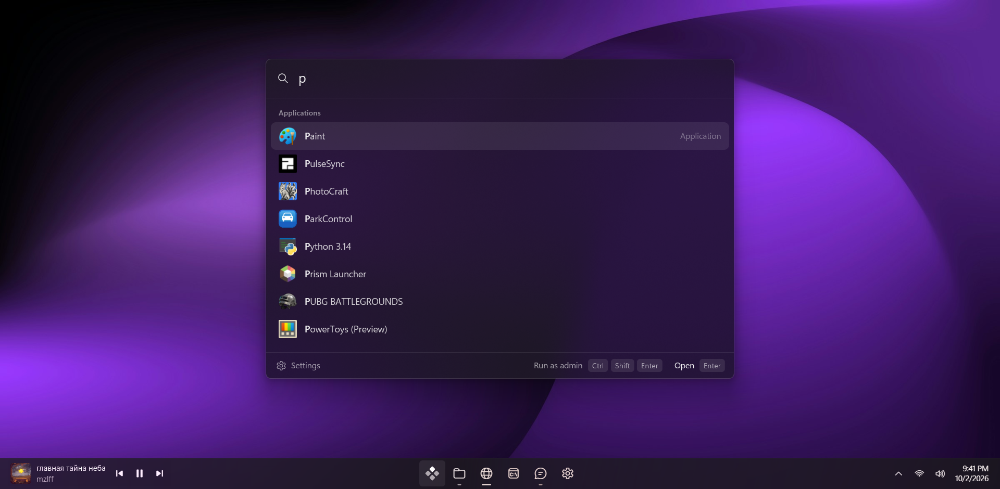
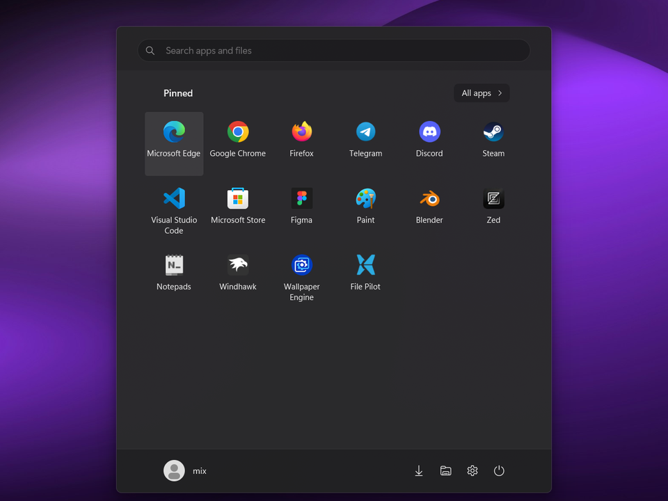
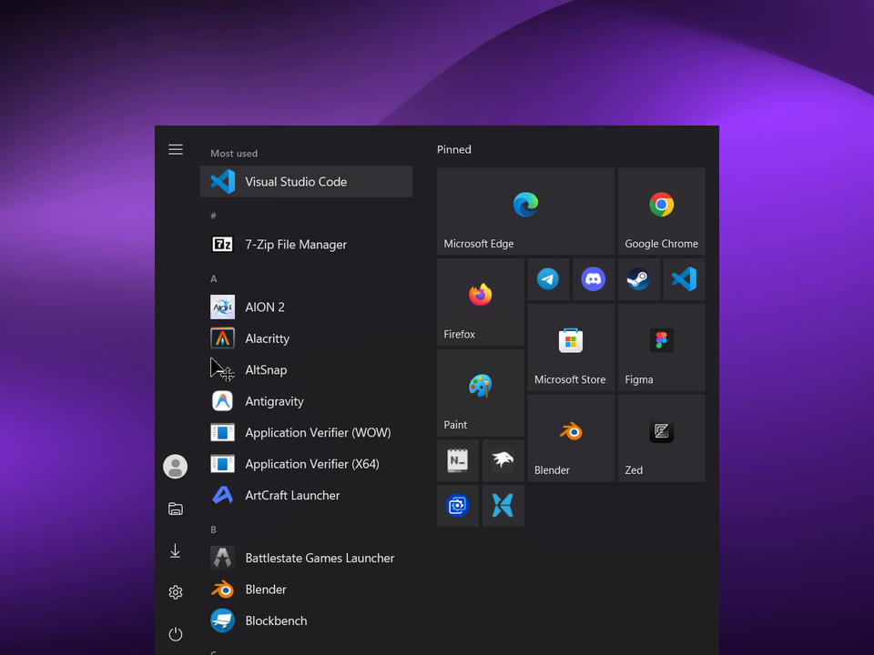
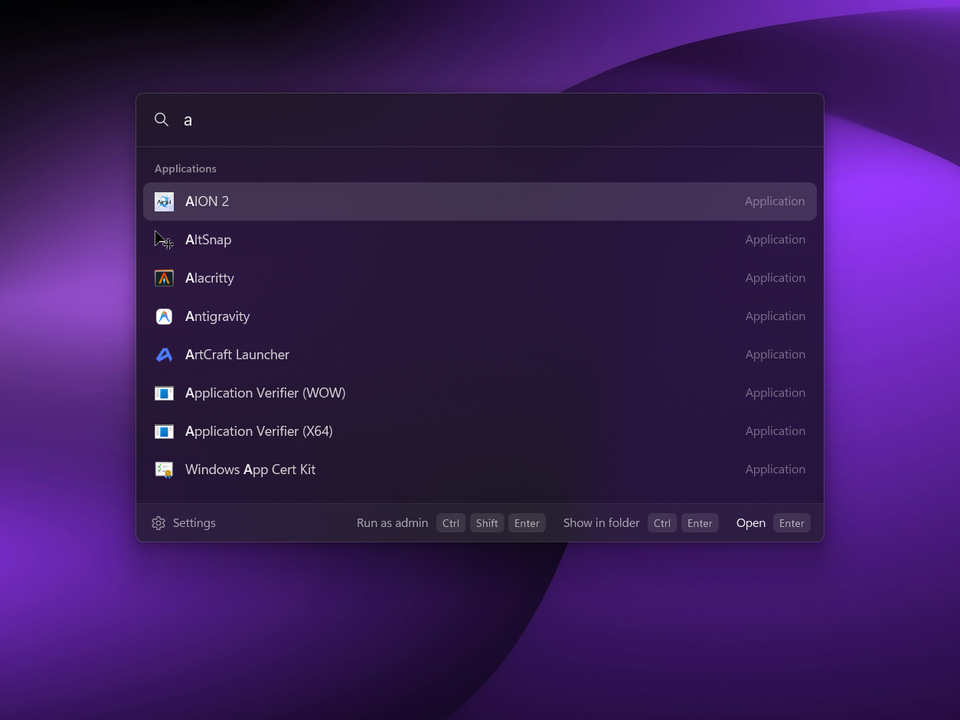
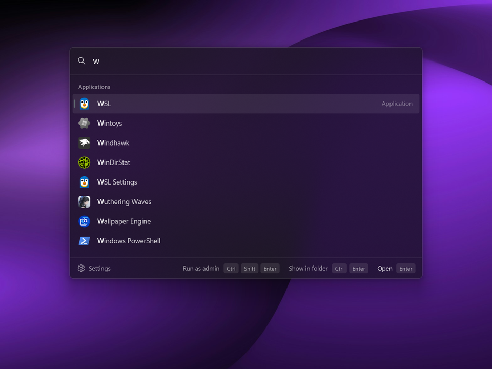

  

<h1 align="center"> MixLauncher</h1>

  A fast Start menu replacement for Windows 10 and 11.

  
  
  
  

## Features

- **Lightweight and very fast.** One native ~410 KB app, no frameworks. Opens instantly and runs lighter and faster than the regular Start menu.
- **Apps and files.** Apps from Start and the Microsoft Store, files from the whole disk through the bundled [Everything](https://www.voidtools.com/).
- **Smart search.** Finds apps typed in the wrong layout and by English names on a localized Windows, plus your own tags.
- **Start menu looks.** Windows 11 and Windows 10 with tiles, or a compact list: Standard, Raycast, Fluent, Compact.
- **Taskbar.** Opens with `Win` or the Start button; a now playing widget with playback controls.
- **No AI, no telemetry.**

## Styles

<table>
  <tr>
    <td align="center"> Windows 11</td>
    <td align="center"> Windows 10</td>
  </tr>
  <tr>
    <td align="center"> Raycast</td>
    <td align="center"> Fluent</td>
  </tr>
</table>

## Installation

Download from the [Releases](https://github.com/mel1x/mixlauncher/releases) page:

- `MixLauncher-Setup.exe` - installer, Everything included.
- `MixLauncher-portable.exe` - no installation; file search needs Everything installed.
